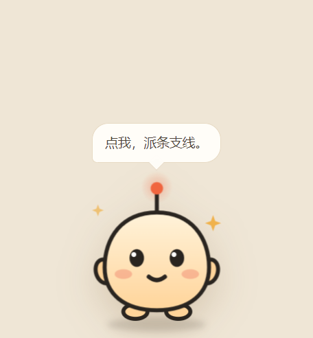
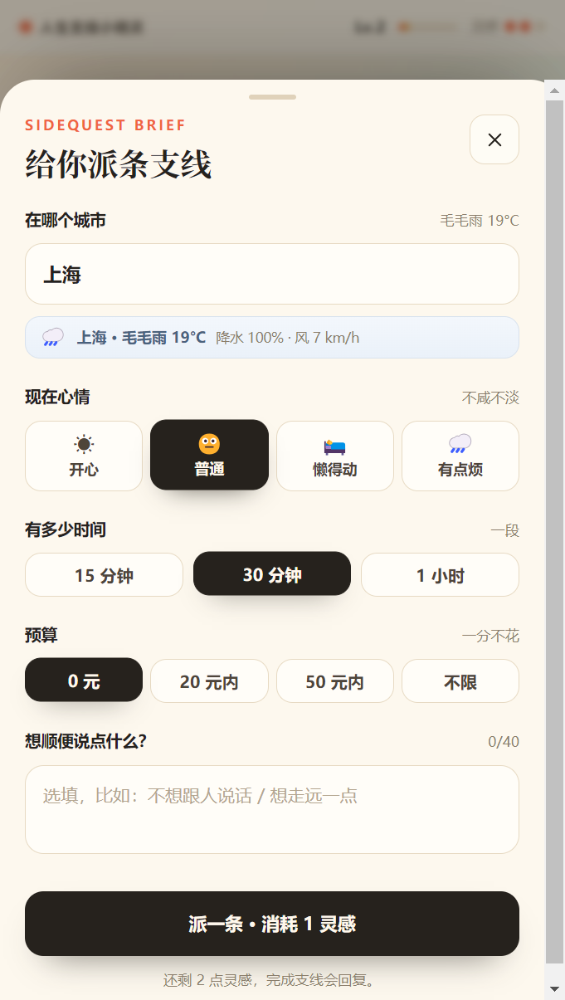
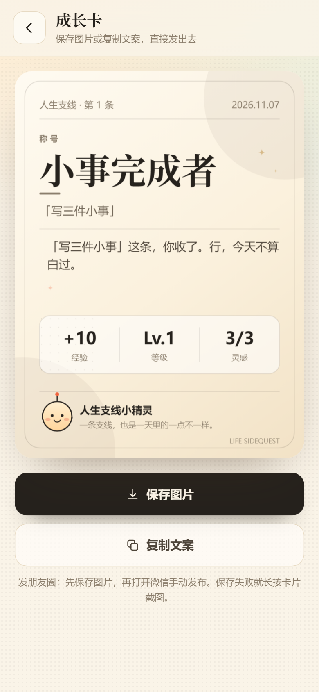

# 人生支线小精灵 · 桌宠版

一只住在 Windows 桌面上的 AI 小精灵。可以拖着走、自己散步、跟着鼠标跑；点它一下，打开「人生支线」面板：选心情/时间/预算，领一条现实支线，完成后结算经验、称号和一张能直接发出去的成长卡。





## 桌宠模式（Windows）

### 启动

**双击桌面上的「人生支线小精灵」图标**即可（已创建）。开始菜单里搜「人生支线小精灵」也能找到。

其他方式：

```bash
npm run pet
```

或双击项目根目录的 **`启动桌宠.vbs`**。

Electron 会自动探测 `http://127.0.0.1:3100`，没有服务就用内置 Node 模式拉起 `server.mjs`，不需要另开终端。

**找不到精灵时**：再双击一次桌面图标。第二次启动会触发单实例重置，把它叫回右下角并说一句「回来了。」；也可以右键精灵或托盘菜单 →「回到右下角」。

### 操作

| 操作 | 效果 |
|---|---|
| 按住精灵拖动 | 拖到桌面任意位置，松手后继续散步 |
| **单击精灵** | 打开支线面板，直接到「派支线」 |
| 右键精灵 | 菜单：派支线 / 我完成了 / 看看成长 / 跟随鼠标 / 散步 / 回到右下角 / 隐藏 / 退出 |
| 托盘图标 | 左键显示/隐藏，右键同一套菜单 |
| 关闭面板 | 精灵说一句「回来了？」 |
| 空闲 | 每 7–15 秒自己走一段，撞到屏幕边缘会换方向 |
| 跟随鼠标 | 菜单勾选后，精灵以缓动跟在光标右下方 |

关闭支线面板只是隐藏窗口，精灵仍在桌面；**退出**请用右键菜单或托盘菜单的「退出」。

想开机自启：把桌面快捷方式复制到 `shell:startup`（`Win+R` 输入 `shell:startup` 回车）。

### 桌宠是怎么实现的

- Electron 33：透明、无边框、置顶、跳过任务栏的 240×300 窗口。窗口会挡住它覆盖的区域，但**只有精灵本体**响应左键/右键；透明边缘不触发。
- **不做点击穿透**：之前用「光标命中精灵才关闭穿透」的方案在 Windows 高 DPI 下会出现坐标偏差，导致窗口一直保持穿透、左右键都点不到；现在由 Windows 原生命中测试处理。
- **固定窗口尺寸**：所有移动都用 `setBounds` 显式带上 240×300，避免 Windows/DPI 下 `setPosition` 把窗口越拖越大（曾出现窗口涨到 3698×334、覆盖屏幕中央的问题）。`keepOnScreen` 每 1.5 秒兜底修正尺寸和位置。
- **边界保护**：散步目标留 40px 边距、拖拽/跟随留 10px 边距，另有每 1.5 秒一次的 `keepOnScreen` 兜底；菜单和托盘都有「回到右下角」，迷路了可以一键找回。
- **拖拽**：主进程 16ms 跟随全局光标移动窗口，位移超过 10px 才算拖拽，否则按单击处理（单击直接开面板）。
- **散步**：空闲 7–15 秒触发，随机方向 90–310px，缓入缓出，严格限制在当前显示器工作区内。
- **跟随**：30fps 缓动追踪 `screen.getCursorScreenPoint()`，目标点带 64/56 的右下偏移。
- **面板联动**：`?desktop=1&action=input|complete|growth`，面板里隐藏网页版的重复精灵；面板已打开时优先执行页面内按钮，不重载丢进度。
- 所有 Electron 缓存、userData、崩溃转储都在项目的 `.cache/`（D 盘）。

## 网页模式

```bash
npm run dev
```

打开 `http://localhost:3000`。网页版和桌宠面板共用同一套前端与 API，但 localStorage 各自独立（桌宠面板的数据存在 Electron 的 userData 里）。

生产：

```bash
npm run build
npm start
```

受限环境可用 `node server.mjs`（3100 端口，桌宠模式用的就是它）。




## 配置 AI（可选）

双击桌面上的 **「配置 AI Key」**，会打开：

```
D:\HuaweiMoveData\Users\64346\Documents\deepseek-harness\default-workspace\life-sidequest\.env.local
```

在 `AI_API_KEY=` 后面粘贴你的 Key，保存：

```bash
AI_API_KEY=sk-...
AI_BASE_URL=https://api.deepseek.com/v1
AI_MODEL=deepseek-chat
```

DeepSeek 用默认的 Base URL / 模型即可；OpenAI 改成 `https://api.openai.com/v1` + `gpt-4o-mini`；其他 OpenAI 兼容接口同理。

硅基流动（SiliconFlow）示例：

```bash
AI_API_KEY=sk-...
AI_BASE_URL=https://api.siliconflow.cn/v1
AI_MODEL=Qwen/Qwen2.5-7B-Instruct
```

注意：SiliconFlow 账户余额不足时会返回 402 `code 30001`，Key 本身有效，但需要充值或换平台。

保存后：右键精灵 → **「重启（应用新 Key）」**；或者右键/托盘「退出」，再双击桌面「人生支线小精灵」。

任意 OpenAI 兼容接口均可。Key 只在服务端读取，不会进入前端 bundle。

不配置 Key 也能完整使用：精灵说话、派支线、结算全部自动走本地兜底内容。

## 城市与天气

输入面板顶部可以填城市（默认上海，带 40+ 常用城市建议），保存后会记住。

- 天气来自 Open-Meteo，**不需要任何 Key**：当天天气、当前温度、最高/最低温、降水概率、风速。
- 雨雪/降水 ≥60%：最多 1 条户外，其余优先室内（如「窗边听雨」）。
- 高温 ≥33°C / 低温 ≤5°C：提示避开正午暴晒或长时间户外。
- 晴天：适当推荐户外（如「晒十分钟太阳」）。
- 天气接口拿不到时，仍然按城市派发，走本地兜底，不会卡住。

城市和天气会一起进入派发 Prompt，也会显示在支线卡页顶部。

## 目录

```
desktop/
  main.cjs            Electron 主进程：窗口、拖拽、散步、跟随、托盘、边界保护
  preload.cjs         IPC 桥
  pet.html/css/js     桌宠外观、表情、气泡、指针交互
  launch.mjs          启动器（自动补 --no-sandbox、拉起 Electron）
  tray.png            托盘图标
启动桌宠.vbs           双击启动（隐藏控制台）

app/
  page.tsx            单页入口
  globals.css         全部样式与动画
  api/talk            精灵说话
  api/missions        派发支线
  api/settle          完成结算
  api/weather         城市天气（Open-Meteo，免 Key）
components/
  App.tsx             状态机、流程编排、localStorage 持久化、桌宠深链
  Home.tsx            主界面 + 精灵 dock + 三个按钮
  InputSheet.tsx      城市/心情/时间/预算输入
  CardsScreen.tsx     3 张支线卡
  ResultModal.tsx     结算弹层
  GrowthScreen.tsx    成长卡与导出
  Spirit.tsx          网页版 SVG 精灵
lib/
  types.ts            类型与选项
  game.ts             等级、灵感、每日重置、记录
  mock.ts             支线池、台词库、结算兜底
  prompts.ts          System Prompt
  schemas.ts          Zod Schema + 业务校验
  ai.ts               OpenAI 兼容调用、超时、JSON 解析
  card.ts             750×1000 Canvas 成长卡
  share.ts            复制/下载
```

## 关键实现

- **状态机**：`IDLE → INPUT → CARDS → ACTIVE → REFLECT → SETTLING → RESULT → CARD`，非法跳转回首页，重复结算按 `missionId` 幂等拦截。
- **养成**：Lv.1–5（0/30/80/150/240），普通 +10 / 稀有 +20 / 离谱 +35；灵感上限 3，派发与换一批各 −1，完成 +1，每日 00:00 回满；亲密度累计完成 3 / 8 条后解锁更熟的台词。
- **AI 三层校验**：`JSON.parse` → Zod Schema → 业务规则（预算 0 禁消费词、时长不超、离谱最多 1 条、最近 7 条去重、空感受禁编造）。失败带错误原因重试 1 次，再失败走本地兜底。
- **城市天气**：服务端先查 Open-Meteo（20 分钟缓存），把城市、天气、温度、降水写进 Prompt；雨天业务层强制最多 1 条户外；本地支线池也有天气加权和专门的雨/晴/冷/热/雪任务。
- **兜底**：说话走本地台词库；派发走参数化支线池（按心情/时间/预算 + 天气过滤 + 标签去重）；结算按支线 tags 选称号 + 模板拼接。无 Key 时全程静默降级。
- **安全**：Key 服务端、按 IP 限流、请求体上限、自由文本清洗并截断 40 字。
- **分享**：Canvas 直出 750×1000 PNG（无第三方截图库），复制文案不带链接，适配朋友圈手动发布。

## 验证

```bash
# 需要 3100 服务在跑（桌宠模式下会自动起）
node scripts/smoke.mjs        # 49 项接口/业务规则
node scripts/weather-check.mjs # 雨天全室内 / 晴天户外任务验证
node scripts/state-tests.mjs  # 8 项持久化/跨天/上限/坏数据（需 Chrome CDP 9222）
node scripts/e2e.mjs          # 25 项完整交互（需 Chrome CDP 9222）
```

AI 链路可用本地假接口验证：

```bash
node scripts/mock-ai.mjs
# 另一个终端带 AI_API_KEY / AI_BASE_URL=http://127.0.0.1:3200/v1 启动应用
node scripts/ai-pipeline.mjs  # 17 项：合法、重试、Schema 失败、超预算、反编造
```

桌宠的拖拽/散步/跟随做过真实位移实测：

```
walk  [1152,606] → [872,606]   dx=-280
follow[872,606]  → [962,606]   dx=+90（朝光标）
drag  [962,606]  → [862,526]   dx=-100 dy=-80  distance=128
```

## 边界

只做 5 个页面与 4 个状态。没有账号、饥饿、金币、商店、背包、多精灵、Live2D、分享落地页。

## 磁盘

Electron 二进制、npm 缓存、Electron userData、临时文件全部在 D 盘项目目录；C 盘没有安装任何新依赖。
